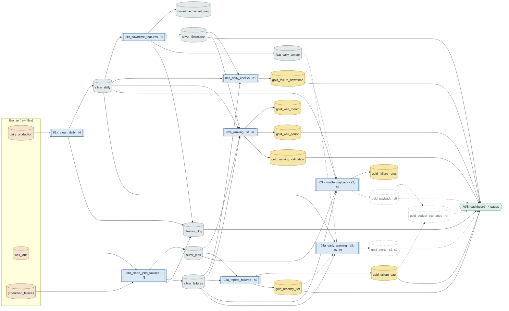

# Notebooks and data flow

How the notebooks are named, which Databricks tables each one reads and writes, and how data moves from the raw files to the dashboard. Task IDs (f4, s1, n2 …) match the [build plan](build_plan.md) and the live plan page. Table and column names below were read from `workspace.dsmlc` on Nov 21.

## Naming conventions

### Notebooks: `<stage><letter>_<name>.py`

| Part | Meaning | Example |
|---|---|---|
| Number | Pipeline stage | `01` = clean and prepare |
| Letter | Run order within the stage | `01a` runs before `01b` |
| Name | What it does, lower snake case | `clean_daily` |

| Stage | Purpose | Plan tasks |
|---|---|---|
| `01` | Clean and prepare: bronze → silver, shared features, data checks | f4, f5, f6, n1 |
| `02` | Who to act on: well tables, cost score, ranking validation | s1, s4 |
| `03` | Why wells fail and what it costs: repeat failures, equipment rates, payback | n2, s2, s5, n4 |
| `04` | Early warning: sensors before failures, threshold rules, 2026 test | s3, s6, s9 |
| `05` | Reserved for weather. Not used: power downtime is not seasonal (n1) | — |

- Each notebook's title line names its task IDs, e.g. `02a · Monthly well table and cost score v1 · tasks s1, s4`.
- Notebooks are saved in Databricks **source format** (`.py` starting with `# Databricks notebook source`), never `.ipynb`, so diffs are readable and no outputs (data rows) reach the public repo.
- A new notebook takes the next free letter in its stage. Example: a separate budget-scenario notebook for n4 would be `03c_budget_scenarios.py`.

### Tables: all in `workspace.dsmlc`

| Layer | Naming | Meaning |
|---|---|---|
| Bronze | Original file names: `daily_production`, `well_jobs`, `production_failures` | The three Parquet files loaded as-is. **Read-only**: never dropped or overwritten |
| Silver | `silver_<entity>` | Cleaned, same grain as the source (one row per well-day, job or failure) |
| Supporting | Descriptive names: `downtime_bucket_map`, `feat_daily_sensor`, `cleaning_log` | Lookup, feature and audit tables built in stage 01 |
| Gold | `gold_<subject>` | Analysis-ready tables: aggregates, scores and results for the dashboard and slides |

Always use the full name (`workspace.dsmlc.silver_daily`) in code.

### Columns

| Pattern | Meaning | Examples |
|---|---|---|
| Unit suffix | Unit of the value | `_m3`, `_e3m3`, `_kpa`, `_ftlb`, `_a`, `_pct` (decimal 0–1) |
| `_clean` | Cleaned copy kept next to the raw column | `oil_clean_m3`, `field_est_clean` |
| `_norm` | Mapped to a canonical list | `pcp_pump_make_norm`, `job_category_norm`, `failure_type_norm` |
| `is_` / `has_` | Boolean flag | `is_rate_day`, `is_repair`, `is_downhole`, `has_90d_followup` |
| `_id` | Stable hash key created in silver | `job_id`, `failure_id` |
| `_7d` / `_base` / `_chg` | 7-day mean, baseline mean (days −37 to −8), change vs baseline | `efficiency_7d`, `efficiency_base`, `efficiency_chg` |
| `_n7` / `_nbase` | Readings behind the 7-day and baseline means | `torque_n7` |
| `rank_` / `_pct` | Rank within a period (1 = most costly) and its percentile | `rank_cost`, `rank_cost_pct` |
| `refail_<h>` | Another failure on the same well within h days | `refail_90` |

## Data flow

Solid lines exist today. Dashed lines and grey boxes are planned in the build plan.



### Run order

```
01a_clean_daily ─┬─► 01c_downtime_features ─► 01d_daily_checks
01b_clean_jobs_failures ─────────────────────┘
        │ (stage 01 complete)
        ├─► 02a_ranking (s1, then s4)
        ├─► 03a_repeat_failures ─► 03b_runlife_payback (s5 needs gold_failure_downtime from 01d)
        └─► 04a_early_warning (s6/s9 compare against gold_recency_tier from 03a)
```

`01a` and `01b` don't depend on each other. Stages 02, 03 and 04 can run in any order once stage 01 is done, except for the two planned links noted above.

## Notebooks

| Notebook | Tasks | Owner | Reads | Writes | Status (Nov 21) |
|---|---|---|---|---|---|
| `01a_clean_daily.py` | f4 | Angie | `daily_production` | `silver_daily`, `cleaning_log` | Ran in Databricks |
| `01b_clean_jobs_failures.py` | f5 | Jacob | `well_jobs`, `production_failures`, `daily_production` (well list) | `silver_jobs`, `silver_failures`, `cleaning_log` | Ran |
| `01c_downtime_features.py` | f6 | Ananya | `silver_daily` | `downtime_bucket_map`, `silver_downtime`, `feat_daily_sensor`, `cleaning_log` | Ran |
| `01d_daily_checks.py` | n1 | Ananya | `silver_daily`, `silver_downtime`, `silver_failures` | `gold_failure_downtime` | Ran |
| `02a_ranking.py` | s1, s4 | Angie | `silver_daily`, `silver_downtime`, `silver_jobs`, `silver_failures` | `gold_well_month`, `gold_well_period`, `gold_ranking_validation` | s1 ran (netback C$32.50); s4 written and tested, not yet run in Databricks |
| `03a_repeat_failures.py` | n2 | Jacob | `silver_failures`, `silver_jobs` | `gold_failure_gap`, `gold_recency_tier` | Ran |
| `03b_runlife_payback.py` | s2 (s5 next) | Jacob | `silver_daily`, `silver_failures`, `silver_jobs` (+ `gold_failure_downtime` for s5) | `gold_failure_rates` (+ `gold_payback` for s5) | s2 ran; s5 not written. Jacob's `pick_2_actions_jacob_m.ipynb` holds early s5 work |
| `04a_early_warning.py` | s3 (s6, s9 next) | Ananya | `silver_daily`, `silver_failures` (+ `feat_daily_sensor`, `gold_recency_tier` for s6/s9) | Nothing yet (+ `gold_alerts` for s6/s9) | s3 done locally; s6/s9 not written |

Task n3 (strategy case and 30/60/90 plan) has no notebook; it uses the outputs above.

## Tables

Row counts are from Databricks on Nov 21.

### Bronze

| Table | Grain | Rows | Written by | Notes |
|---|---|---|---|---|
| `daily_production` | well × day | 5,075,590 | f1 (load) | 42 columns incl. `_rescued_data` from the loader |
| `well_jobs` | one job | 15,610 | f1 | |
| `production_failures` | one failure | 2,873 | f1 | Failure log is live only from Jun 2025 |

### Silver and supporting

| Table | Grain (key) | Rows | Written by | Used by | Main additions over bronze |
|---|---|---|---|---|---|
| `silver_daily` | well × day (`uwi`, `production_date`) | 5,075,561 | 01a | 01c, 01d, 02a, 03b, 04a | 29 duplicates removed; impossible readings nulled; `oil_clean_m3`, `water_clean_m3`, `gas_clean_e3m3`, `pcp_pump_make_norm`, `water_cut`, `runtime_frac`, `is_rate_day` |
| `silver_jobs` | job (`job_id`) | 15,587 | 01b | 01b (link), 02a, 03a, 03b | 23 duplicates removed; `job_category_norm`, `field_est_clean`, `is_repair`, `duration_days_from_dates` |
| `silver_failures` | failure (`failure_id`) | 2,867 | 01b | 01d, 02a, 03a, 03b, 04a | 6 duplicates removed; `failure_type_norm`, `rod_kind`; linked repair job (`job_id`, `linked_job_cost`, `days_to_job`, `job_shared`); 2,812 linked |
| `cleaning_log` | rule × run | grows each run | 01a, 01b, 01c | Dashboard page 1 (data trust) | `target`, `rule`, `column_name`, `rows_affected`, `run_at` (filter to the latest `run_at`) |
| `downtime_bucket_map` | code pair (`downtime_code_1`, `downtime_code_2`) | 164 | 01c | 01c | `bucket`, `downhole_component`, with rows, hours and lost oil per pair |
| `silver_downtime` | well × day with downtime or lost oil | 1,840,596 | 01c | 01d, 02a, dashboard page 1 | `bucket`, `downhole_component`, `is_downhole` |
| `feat_daily_sensor` | producing well × day | 3,778,696 | 01c | 04a (s6/s9) | Sensors on rate days only; `_7d`, `_base`, `_chg` per signal. Mostly null off rate days and on non-PCP wells by design |

### Gold

| Table | Grain (key) | Rows | Written by | Used by | What it answers |
|---|---|---|---|---|---|
| `gold_failure_downtime` | failure (`failure_id`), Jun 2025+, rods/pump/tubing | 2,800 | 01d (n1) | 03b (s5), dashboard page 3 | Stop day, restart day, days down, downhole lost oil from the stop day |
| `gold_well_month` | well × month (`uwi`, `month`) | 167,562 | 02a (s1) | 02a (s4), dashboard page 1 | Production, downtime by bucket, repair jobs and $, failures per month; `period` = train / test |
| `gold_well_period` | well × period (`uwi`, `period`) | 5,240 | 02a (s1) | 02a (s4), dashboard page 2 | Period totals, `eligible`, `cost_score` at C$32.50, ranks |
| `gold_ranking_validation` | ranker × target × k | 48 (after next run) | 02a (s4) | Dashboard page 2, slides | capture@k, lift, 95% intervals, persistence. Created on the next 02a run |
| `gold_failure_gap` | failure (`failure_id`) | 2,867 | 03a (n2) | Dashboard page 2, n4 | Days to the next failure; `refail_30`, `refail_90` |
| `gold_recency_tier` | well × snapshot (`uwi`, `snapshot_date`) | 14,478 | 03a (n2) | Dashboard pages 2 and 4, 04a (s6/s9) | Tier 0/1/2/3+ and next-90-day outcome; `is_current` rows (814 wells) feed the weekly work list |
| `gold_failure_rates` | dimension × scope × area × group | 186 | 03b (s2) | 03b (s5), slides | Failures per well-year by pump make, model, RPM band within area, with intervals and `vs_area` |
| `gold_payback` | action × scenario | planned | 03b (s5) | Dashboard page 3 | Cost per failure, break-even, sensitivity grid |
| `gold_budget_scenarios` | scenario × well | planned | n4 (notebook TBD, e.g. `03c_budget_scenarios`) | Dashboard page 3 | Which wells to treat for 25/50/100/200-well budgets |
| `gold_alerts` | well × day alert | planned | 04a (s6, s9) | Dashboard page 4 | Threshold-rule alerts and their 2026 test metrics |

## Dashboard pages and their tables

Matches the four pages in the build plan.

| Page | Task | Owner | Tables |
|---|---|---|---|
| 1 · Where barrels and dollars go | n5 | Angie | `silver_downtime`, `gold_well_month`, `cleaning_log` |
| 2 · Weekly work list and repeat failures | s7 | Angie | `gold_recency_tier` (`is_current`), `gold_well_period`, `gold_failure_gap`, `gold_ranking_validation` |
| 3 · Payback and budget scenarios | s8 | Jacob | `gold_payback`, `gold_budget_scenarios`, `gold_failure_downtime` |
| 4 · Watchlist and early warning | s9 | Ananya | `gold_alerts`, `gold_recency_tier` |

## Rules

- Bronze is read-only. Fixes go in silver.
- A notebook writes only the tables listed for it above.
- Silver was frozen at Checkpoint 1; later data issues go in [known_issues.md](known_issues.md).
- New tables follow the layer naming above and get a row in this file.

See also [databricks_github_practice.md](databricks_github_practice.md) for Git folders and ownership, and [databricks_api_token_setup.md](databricks_api_token_setup.md) for CLI access.
