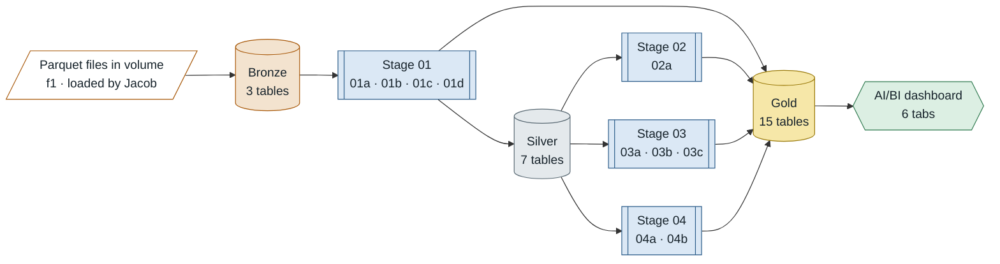
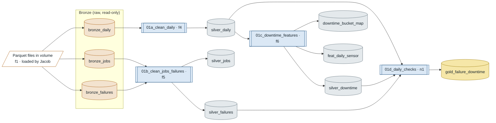
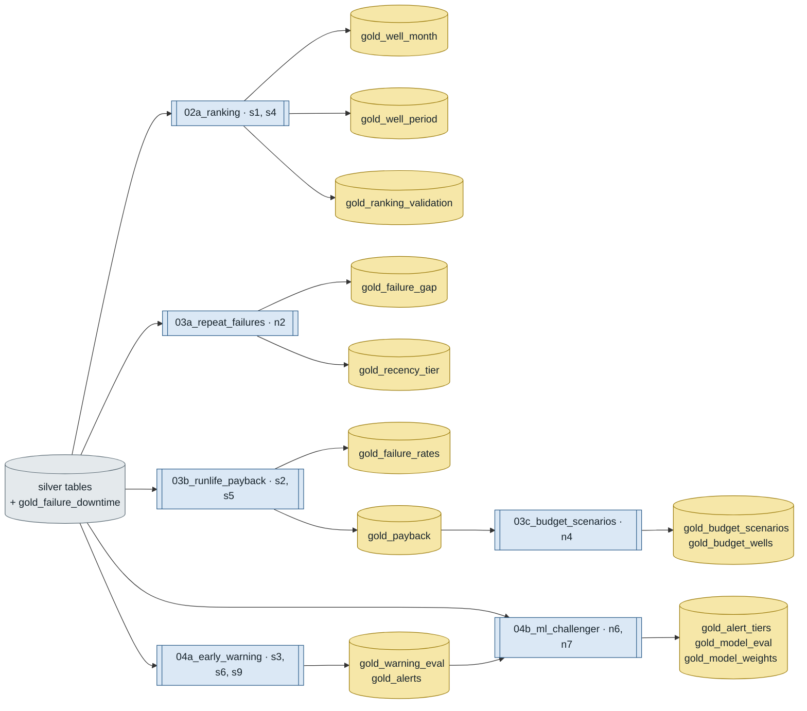
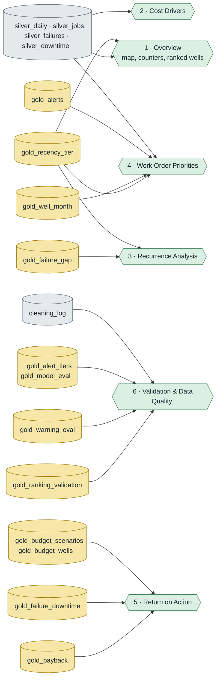

# Notebooks and data flow

How the notebooks are named, which Databricks tables each one reads and writes, and how data moves from the raw files to the dashboard. Task IDs (f4, s1, n2 …) match the [build plan](build_plan.md) and the live plan page. Table and column names below were read from `workspace.dsmlc` on Nov 21.

## Naming conventions

### Notebooks: `<stage><letter>_<name>.py`

| Part | Meaning | Example |
|---|---|---|
| Number | Pipeline stage | `01` = clean and prepare |
| Letter | Run order within the stage | `01a` runs before `01b` |
| Name | What it does, lower snake case | `clean_daily` |

| Stage | Purpose | Plan tasks |
|---|---|---|
| `01` | Clean and prepare: bronze → silver, shared features, data checks | f4, f5, f6, n1 |
| `02` | Who to act on: well tables, cost score, ranking validation | s1, s4 |
| `03` | Why wells fail and what it costs: repeat failures, equipment rates, payback | n2, s2, s5, n4 |
| `04` | Early warning: sensors before failures, threshold rules, 2026 test | s3, s6, s9 |
| `05` | Reserved for weather. Not used: power downtime is not seasonal (n1) | — |

- Each notebook's title line names its task IDs, e.g. `02a · Monthly well table and cost score v1 · tasks s1, s4`.
- Notebooks are saved in Databricks **source format** (`.py` starting with `# Databricks notebook source`), never `.ipynb`, so diffs are readable and no outputs (data rows) reach the public repo.
- A new notebook takes the next free letter in its stage. Example: a separate budget-scenario notebook for n4 would be `03c_budget_scenarios.py`.

### Tables: all in `workspace.dsmlc`

| Layer | Naming | Meaning |
|---|---|---|
| Bronze | `bronze_<entity>`: `bronze_daily`, `bronze_jobs`, `bronze_failures` | The three Parquet files (`daily_production.parquet`, `well_jobs.parquet`, `production_failures.parquet`) loaded as-is. **Read-only**: never dropped or overwritten |
| Silver | `silver_<entity>` | Cleaned, same grain as the source (one row per well-day, job or failure) |
| Supporting | Descriptive names: `downtime_bucket_map`, `feat_daily_sensor`, `cleaning_log` | Lookup, feature and audit tables built in stage 01 |
| Gold | `gold_<subject>` | Analysis-ready tables: aggregates, scores and results for the dashboard and slides |

Always use the full name (`workspace.dsmlc.silver_daily`) in code.

### Columns

| Pattern | Meaning | Examples |
|---|---|---|
| Unit suffix | Unit of the value | `_m3`, `_e3m3`, `_kpa`, `_ftlb`, `_a`, `_pct` (decimal 0–1) |
| `_clean` | Cleaned copy kept next to the raw column | `oil_clean_m3`, `field_est_clean` |
| `_norm` | Mapped to a canonical list | `pcp_pump_make_norm`, `job_category_norm`, `failure_type_norm` |
| `is_` / `has_` | Boolean flag | `is_rate_day`, `is_repair`, `is_downhole`, `has_90d_followup` |
| `_id` | Stable hash key created in silver | `job_id`, `failure_id` |
| `_7d` / `_base` / `_chg` | 7-day mean, baseline mean (days −37 to −8), change vs baseline | `efficiency_7d`, `efficiency_base`, `efficiency_chg` |
| `_n7` / `_nbase` | Readings behind the 7-day and baseline means | `torque_n7` |
| `rank_` / `_pct` | Rank within a period (1 = most costly) and its percentile | `rank_cost`, `rank_cost_pct` |
| `refail_<h>` | Another failure on the same well within h days | `refail_90` |

## Data flow

Read the overview first, then the detail for the stage you work on. Cylinders are Databricks tables, double-edged boxes are notebooks. Everything shown exists in Databricks (Nov 22).

The three bronze tables are **not made by any notebook in this repo**. Jacob loaded them in task f1: the Parquet files sit in the volume `workspace.dsmlc.dataset`, and the `_rescued_data` column shows they were read with Databricks' file loader. To make the repo fully reproducible, that load could be saved as `00a_load_bronze.py`.

### Overview



### Stage 01 · clean and prepare



`01a`, `01b` and `01c` also append one row per cleaning rule to `cleaning_log`.

### Stages 02–04 · analysis



### Into the dashboard

Built by `dashboard/build_dashboard.py`. Tab 1 reads one well-level query, so clicking a well on its map filters the rest of the tab.



### Run order

```
01a_clean_daily ─┬─► 01c_downtime_features ─► 01d_daily_checks
01b_clean_jobs_failures ─────────────────────┘
        │ (stage 01 complete)
        ├─► 02a_ranking (s1, then s4)
        ├─► 03a_repeat_failures ─► 03b_runlife_payback ─► 03c_budget_scenarios (needs gold_payback)
        └─► 04a_early_warning ─► 04b_ml_challenger (checks itself against gold_warning_eval)
```

`01a` and `01b` don't depend on each other. Stages 02, 03 and 04 can run in any order once stage 01 is done; within a stage, run the letters in order.

## Notebooks

| Notebook | Tasks | Owner | Reads | Writes | Status (Nov 22) |
|---|---|---|---|---|---|
| `01a_clean_daily.py` | f4 | Angie | `bronze_daily` | `silver_daily`, `cleaning_log` | Ran |
| `01b_clean_jobs_failures.py` | f5 | Jacob | `bronze_jobs`, `bronze_failures`, `bronze_daily` (well list) | `silver_jobs`, `silver_failures`, `cleaning_log` | Ran |
| `01c_downtime_features.py` | f6 | Ananya | `silver_daily` | `downtime_bucket_map`, `silver_downtime`, `feat_daily_sensor`, `cleaning_log` | Ran |
| `01d_daily_checks.py` | n1 | Ananya | `silver_daily`, `silver_downtime`, `silver_failures` | `gold_failure_downtime` | Ran |
| `02a_ranking.py` | s1, s4 | Angie | `silver_daily`, `silver_downtime`, `silver_jobs`, `silver_failures` | `gold_well_month`, `gold_well_period`, `gold_ranking_validation` | Ran (netback C$32.50) |
| `03a_repeat_failures.py` | n2 | Jacob | `silver_failures`, `silver_jobs` | `gold_failure_gap`, `gold_recency_tier` | Ran |
| `03b_runlife_payback.py` | s2, s5 | Jacob | `silver_daily`, `silver_failures`, `silver_jobs`, `gold_failure_downtime`, `gold_well_period` (netback) | `gold_failure_rates`, `gold_payback` | Ran |
| `03c_budget_scenarios.py` | n4 | Jacob | `silver_daily`, `silver_failures`, `gold_payback` | `gold_budget_wells`, `gold_budget_scenarios` | Ran |
| `04a_early_warning.py` | s3, s6, s9 | Ananya | `silver_daily`, `silver_downtime`, `feat_daily_sensor`, `gold_failure_downtime` (stop days), `silver_failures` (recency baseline) | `gold_warning_eval`, `gold_alerts` | Ran |
| `04b_ml_challenger.py` | n6, n7 | Angie | `silver_daily`, `silver_failures`, `silver_jobs`, `gold_failure_downtime`, `gold_warning_eval` (check) | `gold_alert_tiers`, `gold_model_eval`, `gold_model_weights` | Ran on serverless; all checks pass |

Task n3 (strategy case and 30/60/90 plan) has no notebook; it uses the outputs above.

## Tables

Row counts are from Databricks on Nov 21.

### Bronze

| Table | Grain | Rows | Written by | Notes |
|---|---|---|---|---|
| `bronze_daily` | well × day | 5,075,590 | f1: loaded from the volume `workspace.dsmlc.dataset` (no notebook in the repo) | 42 columns incl. `_rescued_data` from the loader |
| `bronze_jobs` | one job | 15,610 | f1 (same load) | |
| `bronze_failures` | one failure | 2,873 | f1 (same load) | Failure log is live only from Jun 2025 |

### Silver and supporting

| Table | Grain (key) | Rows | Written by | Used by | Main additions over bronze |
|---|---|---|---|---|---|
| `silver_daily` | well × day (`uwi`, `production_date`) | 5,075,561 | 01a | 01c, 01d, 02a, 03b, 04a | 29 duplicates removed; impossible readings nulled; `oil_clean_m3`, `water_clean_m3`, `gas_clean_e3m3`, `pcp_pump_make_norm`, `water_cut`, `runtime_frac`, `is_rate_day` |
| `silver_jobs` | job (`job_id`) | 15,587 | 01b | 01b (link), 02a, 03a, 03b | 23 duplicates removed; `job_category_norm`, `field_est_clean`, `is_repair`, `duration_days_from_dates` |
| `silver_failures` | failure (`failure_id`) | 2,867 | 01b | 01d, 02a, 03a, 03b, 04a | 6 duplicates removed; `failure_type_norm`, `rod_kind`; linked repair job (`job_id`, `linked_job_cost`, `days_to_job`, `job_shared`); 2,812 linked |
| `cleaning_log` | rule × run | grows each run | 01a, 01b, 01c | Dashboard tab 6 (data quality) | `target`, `rule`, `column_name`, `rows_affected`, `run_at` (filter to the latest `run_at`) |
| `downtime_bucket_map` | code pair (`downtime_code_1`, `downtime_code_2`) | 164 | 01c | 01c | `bucket`, `downhole_component`, with rows, hours and lost oil per pair |
| `silver_downtime` | well × day with downtime or lost oil | 1,840,596 | 01c | 01d, 02a, dashboard tabs 1, 2 and 4 | `bucket`, `downhole_component`, `is_downhole` |
| `feat_daily_sensor` | producing well × day | 3,778,696 | 01c | 04a (s6/s9) | Sensors on rate days only; `_7d`, `_base`, `_chg` per signal. Mostly null off rate days and on non-PCP wells by design |

### Gold

| Table | Grain (key) | Rows | Written by | Used by | What it answers |
|---|---|---|---|---|---|
| `gold_failure_downtime` | failure (`failure_id`), Jun 2025+, rods/pump/tubing | 2,800 | 01d (n1) | 03b, 04a, 04b, dashboard tab 5 | Stop day, restart day, days down, downhole lost oil from the stop day |
| `gold_well_month` | well × month (`uwi`, `month`) | 167,562 | 02a (s1) | 02a (s4), dashboard tab 4 | Production, downtime by bucket, repair jobs and $, failures per month; `period` = train / test |
| `gold_well_period` | well × period (`uwi`, `period`) | 5,240 | 02a (s1) | 02a (s4), 03b (netback) | Period totals, `eligible`, `cost_score` at C$32.50, ranks |
| `gold_ranking_validation` | ranker × target × k | 48 | 02a (s4) | Dashboard tab 6, slides | capture@k, lift, 95% intervals, persistence |
| `gold_failure_gap` | failure (`failure_id`) | 2,867 | 03a (n2) | Dashboard tab 3 | Days to the next failure; `refail_30`, `refail_90` |
| `gold_recency_tier` | well × snapshot (`uwi`, `snapshot_date`) | 14,478 | 03a (n2) | 04a, dashboard tabs 1, 3 and 4 | Tier 0/1/2/3+ and next-90-day outcome; `is_current` rows (814 wells) feed the weekly work list |
| `gold_failure_rates` | dimension × scope × area × group | 186 | 03b (s2) | Slides | Failures per well-year by pump make, model, RPM band within area, with intervals and `vs_area` |
| `gold_payback` | action × netback × action cost × avoided share | 36 | 03b (s5) | 03c, dashboard tab 5 | Bad-actor wells (picked Jun–Dec 2025, rate measured Jan–Oct 2026), mean cost per failure, failures to recover cost, yearly savings, payback years |
| `gold_budget_wells` | well (`rank`) | 1,145 | 03c (n4) | Dashboard tab 5 | Every eligible well ranked by expected value per year (Gamma–Poisson shrinkage toward the area rate), with the action and cost |
| `gold_budget_scenarios` | budget scenario | 4 | 03c (n4) | Dashboard tab 5 and global filter | Cost, wells per action, expected and measured savings and payback for the 25 / 50 / 100 / 200-well budgets |
| `gold_warning_eval` | window × rule | 6 | 04a (s6, s9) | 04b (check), dashboard tab 6 | Precision, recall, alerts per area-week and warning days for the runtime rule, the recency watchlist and both, on 2025 tuning and 2026 holdout |
| `gold_alerts` | well × alert day | 5,913 | 04a (s6, s9) | Dashboard tab 4 | Runtime-rule alerts with area, rule inputs and `is_current` (86 in the last 14 days) |
| `gold_alert_tiers` | rule or tier | 6 | 04b (n6) | Dashboard tab 6, slides | 2026 alerts split by which rule fired: both rules, watchlist only, runtime rule only, with precision and failures caught |
| `gold_model_eval` | workload × method | 6 | 04b (n7) | Dashboard tab 6, slides | Rules vs logistic regression vs boosted trees with the same number of flags on 2026 |
| `gold_model_weights` | feature | 46 | 04b (n7) | Slides, README | Standardized logistic-regression weights (largest: operating area) |

Three older tables from the first n4 attempt (`gold_cost_per_failure`, `gold_action_payback_grid`, `gold_action_eligible_wells`) are not written by any notebook in this repo and are not used by `build_dashboard.py`. The original live dashboard still reads `gold_action_eligible_wells` for its budget well list until the build from `build_dashboard.py` is pushed to it.

## Dashboard tabs and their tables

There are two dashboards in the workspace:
- **Reliability Investment Dashboard:** the original, edited by hand in the editor.
- **Reliability Investment Dashboard (build_dashboard.py):** built from `dashboard/build_dashboard.py` and published from it.

The script holds every query (`python dashboard/build_dashboard.py test` runs them all on the SQL warehouse) and the full layout. Edits made in the editor are copied back into the script with the `sync-dashboard` skill (`.claude/skills/sync-dashboard/`). `dashboard/Reliability Investment Dashboard.lvdash.json` is an export of the original. Screenshots of each tab are in `dashboard/`.

| Tab | Build plan tasks | What it answers | Tables |
|---|---|---|---|
| 1 · Overview | n8 | The whole story on one page: counters, a map of wells by recent failures, findings and recommendations, cost by area, ranked well list. Opens on wells that failed in the last 90 days | `silver_daily` (location), `gold_recency_tier`, `silver_failures`, `silver_jobs`, `silver_downtime` |
| 2 · Cost Drivers | n5 | Where repair dollars and lost oil go, by cause and failure type, and the monthly spend trend since 2023 | `silver_jobs`, `silver_downtime`, `silver_failures` |
| 3 · Recurrence Analysis | n2 | How often and how fast failures come back, and how recent failures raise the odds of the next one | `gold_failure_gap`, `gold_recency_tier` |
| 4 · Work Order Priorities | s7 | This week's ranked list and the runtime alerts, tiered by which rule fired | `gold_recency_tier` (`is_current`), `gold_well_month`, `gold_alerts`, `silver_*` |
| 5 · Return on Action | s5, s8, n4 | Payback per action, sensitivity, budget scenarios and the wells each budget treats | `gold_payback`, `gold_failure_downtime`, `gold_budget_scenarios`, `gold_budget_wells` |
| 6 · Validation & Data Quality | s4, s9, n6, n7, n5 | Ranking vs size and random, the alert rules and tiers, the ML challenger, and the cleaning log | `gold_ranking_validation`, `gold_warning_eval`, `gold_alert_tiers`, `gold_model_eval`, `cleaning_log` |

Global filters: operating area, UWI (well-level queries only) and budget scenario.

## Rules

- Bronze is read-only. Fixes go in silver.
- A notebook writes only the tables listed for it above.
- Silver was frozen at Checkpoint 1; later data issues go in [known_issues.md](known_issues.md).
- New tables follow the layer naming above and get a row in this file.

See also [databricks_github_practice.md](databricks_github_practice.md) for Git folders and ownership, and [databricks_api_token_setup.md](databricks_api_token_setup.md) for CLI access.
